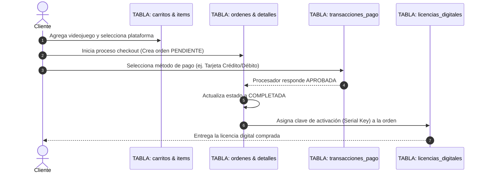

# 🗄️ Documentación de la Base de Datos Relacional - CyberVerse 3D Game Store

## 📌 Visión General
Esta carpeta contiene el diseño, código DDL, datos iniciales (seed), diagramas y especificaciones de la **Base de Datos Relacional** de **CyberVerse Game Store**.

La estructura relacional ha sido diseñada en tercera forma normal (**3NF**) e inspirada directamente en el diseño de la **Pasarela de Pago Segura** de la tienda (pantallazo de pago con tarjeta, PayPal, criptomonedas, PSE/Nequi/OXXO y Apple Pay).

---

## 📂 Estructura de Archivos
- [**`schema.sql`**](file:///C:/Users/ESTUDIANTE/.gemini/antigravity/scratch/cyber-game-store/database/schema.sql): Script DDL en SQL Estándar (ANSI SQL) con creación de tablas, tipos de datos, llaves primarias (`PK`), llaves foráneas (`FK`), restricciones `CHECK` e índices.
- [**`seed_data.sql`**](file:///C:/Users/ESTUDIANTE/.gemini/antigravity/scratch/cyber-game-store/database/seed_data.sql): Poblado inicial de datos (catálogo de juegos 3D, usuarios, plataformas, cupones, métodos de pago de la pasarela y orden de ejemplo de Juan Pérez por COP $180.000).
- [**`db_diagram.mermaid`**](file:///C:/Users/ESTUDIANTE/.gemini/antigravity/scratch/cyber-game-store/database/db_diagram.mermaid): Diagrama Entidad-Relación (ERD) en formato Mermaid.

---

## 🛡️ Seguridad y Cumplimiento PCI-DSS en Pagos
Para proteger los datos financieros del usuario durante la compra:
1. **No se almacenan datos sensibles de tarjeta en texto plano**: Jamás se guardan números de tarjeta completos ni los códigos `CVC`/`CVV`.
2. **Enmascaramiento y Tokenización**: La tabla `detalles_pago_tarjeta` solo registra:
   - Marca de la tarjeta (`VISA`, `MASTERCARD`)
   - Últimos 4 dígitos (`6789`)
   - Nombre del titular (`Juan Pérez`)
   - Fecha de expiración (`MM/AA`)
   - Token de transacción generado por el procesador seguro.
3. **Multimoneda con Precisión Decimal**: Todos los cálculos monetarios utilizan `DECIMAL(12, 2)` para evitar distorsiones por redondeo de coma flotante.

---

## 🔄 Flujo Relacional de una Compra


---

## 📊 Consultas SQL Frecuentes para Administración y Control

### 1. Consultar el Total Vendido por Método de Pago
```sql
SELECT 
    mp.nombre AS metodo_pago,
    COUNT(tp.id) AS total_transacciones,
    SUM(tp.monto) AS total_recaudado_cop
FROM metodos_pago mp
JOIN transacciones_pago tp ON mp.id = tp.metodo_pago_id
WHERE tp.estado_transaccion = 'APROBADA'
GROUP BY mp.id, mp.nombre
ORDER BY total_recaudado_cop DESC;
```

### 2. Consultar el Detalle Completo de una Orden (Ejemplo Juan Pérez - $180.000 COP)
```sql
SELECT 
    o.codigo_referencia,
    u.nombre_completo AS cliente,
    u.email,
    p.titulo AS juego,
    plat.nombre AS plataforma,
    od.precio_unitario_cop,
    ld.clave_activacion AS serial_entregado,
    mp.nombre AS metodo_pago_usado,
    dpt.marca_tarjeta,
    dpt.ultimos_cuatro,
    o.estado AS estado_orden
FROM ordenes o
JOIN usuarios u ON o.usuario_id = u.id
JOIN orden_detalles od ON o.id = od.orden_id
JOIN productos p ON od.producto_id = p.id
JOIN plataformas plat ON od.plataforma_id = plat.id
LEFT JOIN licencias_digitales ld ON od.licencia_id = ld.id
JOIN transacciones_pago tp ON o.id = tp.orden_id
JOIN metodos_pago mp ON tp.metodo_pago_id = mp.id
LEFT JOIN detalles_pago_tarjeta dpt ON tp.id = dpt.transaccion_id
WHERE o.codigo_referencia = 'CYBER-2026-98721';
```

### 3. Verificar Stock de Licencias Digitales Disponibles por Juego
```sql
SELECT 
    p.titulo AS juego,
    plat.nombre AS plataforma,
    COUNT(ld.id) AS licencias_disponibles
FROM productos p
CROSS JOIN plataformas plat
LEFT JOIN licencias_digitales ld ON p.id = ld.producto_id 
    AND plat.id = ld.plataforma_id 
    AND ld.estado = 'DISPONIBLE'
GROUP BY p.id, p.titulo, plat.id, plat.nombre
ORDER BY p.titulo;
```
